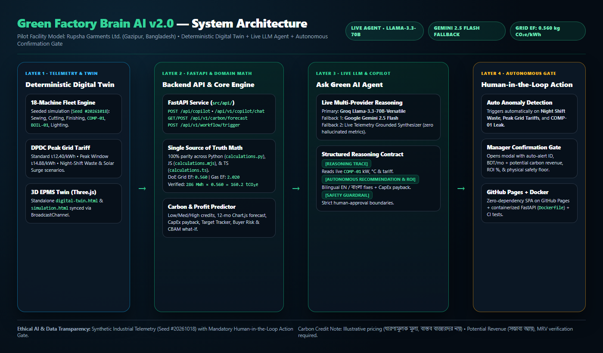

# Green Factory Brain AI (`green-factory-ai`)

**Autonomous Industrial Energy Intelligence, Live LLM Copilot (`Llama-3.3-70B` / `Gemini 2.5 Flash`), Carbon Credit Profit Forecaster & 3D EPMS Digital Twin**

[](https://fahad3235.github.io/green-factory-ai/)
[](https://github.com/fahad3235/green-factory-ai/actions/workflows/ci.yml)
[](Dockerfile)
[](src/agents/copilot_agent.py)
[](LICENSE)

---

## Live Access & Judge Walkthrough

- **GitHub Pages Live Frontend:** [https://fahad3235.github.io/green-factory-ai/](https://fahad3235.github.io/green-factory-ai/)
- **Standalone 3D EPMS Twin:** [https://fahad3235.github.io/green-factory-ai/digital-twin.html](https://fahad3235.github.io/green-factory-ai/digital-twin.html)
- **Standalone Telemetry Simulator:** [https://fahad3235.github.io/green-factory-ai/simulation.html](https://fahad3235.github.io/green-factory-ai/simulation.html)
- **Sandbox Operator Roles (`#/login`):**
  - **Factory Operations Manager:** `GFB-MGR-2026` / Passkey `PASSKEY-MGR-8899` *(Sub-meter alerts, Manager Confirmation Gate approvals, ISO 10816-3 diagnostics)*
  - **C-Suite Factory Owner:** `GFB-OWN-2026` / Passkey `PASSKEY-OWN-9900` *(Tariff economics, BERC Form S-12 compliance, Carbon Credit & ROI forecasts)*
- **1-Click Pitch Deck:** Press **P** anywhere in the app to open the 5-slide executive pitch modal.

> **Digital Twin Sandbox & Data Transparency Notice:**  
> All live telemetry (`Seed #20261018`, Rupsha Garments Ltd. pilot model), scenario triggers, and hardware interlocks run in an isolated simulation sandbox. Physical PLC/breaker writes are disabled; every autonomous agent mitigation requires explicit **Manager Confirmation Gate** approval.

---

## System Architecture



OpenAPI schema contract: [`docs/api-schema.json`](docs/api-schema.json)

---

## Core Upgrades & Capabilities

### 1. Live LLM / Agent Reasoning (`Groq Llama-3.3-70B` & `Gemini 2.5 Flash`)
- Configured cleanly via FastAPI (`POST /api/copilot` & `POST /api/v1/copilot/chat`) or directly in the UI **Live LLM Gateway Settings** (stored locally in browser `localStorage`; never hardcoded in source control).
- Grounded in real-time JSON telemetry (`COMP-01`, `MCH-CUT-02`, `MCH-SEW-03`, active tariff, Scope 1+2 carbon, Business Impact).
- Structured executive responses: `[REASONING TRACE]` → `[AUTONOMOUS RECOMMENDATION & ROI]` → `[SAFETY GUARDRAIL]`, with resilient deterministic telemetry-grounded fallback when running offline or on static hosting without API keys.

### 2. Autonomous Agent Workflow & Manager Confirmation Gate
- Triggering **Night Shift Waste** (`night_idle`), **Peak Grid Tariffs** (`peak_grid`), or **Compressor Air Leak** (`compressor_leak`) automatically:
  1. Mutates live fleet sensor telemetry and department loads,
  2. Generates an unacknowledged telemetry alert (`ALT-AUTO-*`),
  3. Computes monthly savings, potential carbon revenue, 12-month ROI %, and CapEx payback,
  4. Opens the **Manager Confirmation Gate** modal for human approval before applying mitigation in simulation.

### 3. Carbon Credit & Business Profit Prediction (`#/carboniq-report` & Dashboard Business Impact)
- **Dashboard Live Business Impact Card:** Monthly Savings (৳) → Annual Savings → Potential Carbon Credit Revenue → Payback Months, reacting live to 1-click toggles (`Normal Baseline`, `Rooftop Solar Surge`, `Night Shift Waste`, `Peak Grid Tariffs`).
- **3 Credit Price Scenarios + Custom Slider:** Low (`$10/t`), Base (`$18/t`), High (`$30/t`), plus user-editable `$1–$150/t` slider/input.
- **12-Month Projection Graph & ROI Calculator:** Interactive Chart.js trajectory, editable CapEx, payback (energy-only vs with potential credits), 3-year net profit, **Carbon Goal Tracker**, **Buyer Compliance Risk Score**, and **EU CBAM Tax What-If Slider**.
- **Calibrated Math & Honest Market Caveats:** Uses DoE Bangladesh Grid Emission Factor (`0.560 kg CO₂e/kWh` = `0.560 tCO₂e/MWh`, e.g., `286 MWh × 0.560 = 160.2 tCO₂e`) and Natural Gas EF (`2.020 kg CO₂e/m³`). Clearly labels carbon credit income as illustrative **Potential Revenue (`সম্ভাব্য আয়`)** subject to MRV baseline verification (Verra VCS / Gold Standard).

---

## Repository Structure

```text
green-factory-ai/
├── .github/workflows/ci.yml            # GitHub Actions (Node 18/20/22 + Python 3.12 pytest)
├── .env.example                        # Safe environment variable template (no real keys)
├── Dockerfile                          # Containerized FastAPI + static UI build
├── docker-compose.yml                  # Local Docker Compose orchestration
├── requirements.txt                    # Python FastAPI / Pydantic / HTTPX / Pytest deps
├── package.json                        # Node.js test scripts & local preview server
├── server.js                           # Lightweight Node.js static server
├── index.html                          # Root GitHub Pages SPA entrypoint
├── digital-twin.html                   # Root standalone 3D EPMS Digital Twin
├── simulation.html                     # Root standalone deterministic factory simulator
├── docs/
│   ├── architecture.png                # System architecture diagram
│   ├── pitch-deck.pdf                  # 6-slide hackathon judge walkthrough deck
│   └── api-schema.json                 # FastAPI OpenAPI 3.1 specification
├── src/
│   ├── core/config.py                  # Settings loader via python-dotenv
│   ├── core/calculations.py            # Python math engine (JS/TS parity)
│   ├── models/schemas.py               # Pydantic v2 API request/response models
│   ├── agents/copilot_agent.py         # Groq Llama-3.3-70B / Gemini 2.5 Flash + workflow gate
│   ├── api/{routes.py,main.py}         # FastAPI REST endpoints & static UI mounting
│   └── frontend/                       # Synced SPA, 3D Twin, Simulator & TS/JS domain modules
├── tests/
│   └── test_pipeline.py                # FastAPI & calculation pytest suite
├── preview/
│   ├── index.html                      # Development SPA source synced to root
│   ├── digital-twin.html               # Development 3D EPMS Twin synced to root
│   ├── simulation.html                 # Development simulator synced to root
│   ├── src/domain/calculations.{mjs,ts}# JS & TypeScript domain calculation modules
│   └── tests/                          # Domain & E2E verification suites
└── scripts/                            # Carbon parity, tick progression, TS parity & route checks
```

---

## Quick Start (Local, FastAPI, & Docker)

### Option 1: Docker (Recommended Full Stack)
```bash
cp .env.example .env
# Add GROQ_API_KEY or GEMINI_API_KEY to .env (optional — falls back to live telemetry engine if empty)
docker compose up --build
```
Open `http://127.0.0.1:8000/` (API docs at `http://127.0.0.1:8000/docs`).

### Option 2: Python FastAPI Backend + Live Frontend
```bash
pip install -r requirements.txt
cp .env.example .env
uvicorn src.api.main:app --host 0.0.0.0 --port 8000 --reload
```

### Option 3: Static Frontend Preview (Zero Dependencies)
```bash
npm start
# Serves at http://127.0.0.1:4321/
```

---

## Verification & Automated Tests

```bash
# Node.js E2E, domain math, monotonic carbon ticks, route parity, & TS/JS parity
npm run test:all
npm run test:ts
node scripts/test_carbon_credit_integration.js

# Python FastAPI backend & formula parity suite
pytest -v
```

---

*Green Factory Brain AI — Smarter Energy. Lower Costs. Verifiable Climate Impact.*
